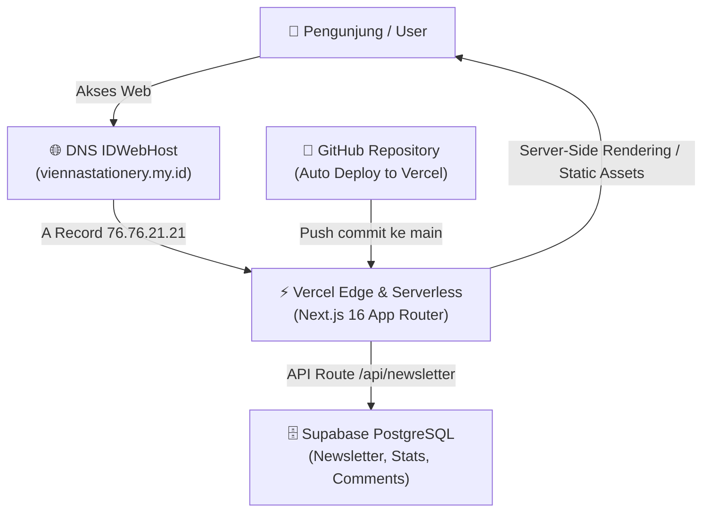

<div align="center">

# 🌸 Vienna Stationery — Official Website & Journal

**An aesthetic, modern digital experience crafted for stationery enthusiasts, thoughtful journaling, and mindful desk curation.**

[](https://nextjs.org/)
[](https://react.dev/)
[](https://www.typescriptlang.org/)
[](https://tailwindcss.com/)
[](https://supabase.com/)
[](https://vercel.com/)

[**🌐 Live Website**](https://viennastationery.my.id) • [**⚡ Alternative Mirror**](https://viennastationery-webs.vercel.app)

</div>

---

## 📖 Overview

**Vienna Stationery** adalah platform web modern yang memadukan katalog produk stationery estetis, artikel jurnal inspiratif seputar produktivitas dan gaya hidup, serta narasi kreatif dari tim di balik brand. 

Dibangun dengan standar web modern menggunakan **Next.js 16 App Router**, **React 19**, **TypeScript**, dan **Tailwind CSS v4**, website ini dirancang untuk memberikan pengalaman menjelajah yang lembut (*calm & cozy*), responsif, dan kaya fitur interaktif.

---

## ✨ Fitur Utama

- 🌐 **Dukungan Bilingual Penuh (ID & EN):**
  - Switcher bahasa instan tanpa refresh halaman via React Context (`LanguageContext`).
  - Menyimpan preferensi bahasa pengguna di `localStorage`.
  - Terjemahan komprehensif mencakup antarmuka UI, katalog produk, hingga seluruh isi artikel jurnal.

- 📝 **Vienna Journal (Bilingual Blog System):**
  - 23 artikel kurasi dengan tipografi elegan (Dropcap, H2/H3 headings, pull quotes).
  - Integrasi video player internal di dalam artikel (misalnya video penataan meja belajar).
  - Dynamic Reading Progress Bar, Sticky Social Sharing, Polaroid Image Gallery, dan Author Bio.
  - Filter kategori, tag-based discovery, dan halaman arsip lengkap.

- 🛍️ **Katalog Produk Stationery:**
  - 75 produk terkurasi dalam 14 kategori (Highlighter, Kertas Binder, Notebook & Notepad, Pulpen & Tinta, Tempat Pensil, dll).
  - Pencarian real-time dan penyaringan berbasis kategori yang cepat.
  - Tampilan card bernuansa pastel dengan efek hover interaktif.

- 💌 **Integrasi Newsletter (Supabase PostgreSQL):**
  - Formulir pendaftaran newsletter real-time di Footer dan Journal page.
  - Terkoneksi langsung ke database Supabase melalui API route Next.js (`/api/newsletter`) dengan proteksi Row Level Security (RLS).

- 👥 **Halaman "People Behind This Web":**
  - Profil interaktif anggota tim pengembang dengan foto asli dan kutipan perannya.
  - Interactive brand timeline dan kumpulan fun facts.

- 🎨 **Sistem Desain Kustom (Custom Aesthetic Identity):**
  - Palet warna lembut: *Vienna Rose, Cream, Lavender, Sage, Sand, Offwhite*.
  - Aksen visual khas: *Washi tape decor, Polaroid frames, Paper texture background*.
  - Tipografi terkurasi: *Fredoka, Comfortaa, Nunito, Playfair Display, Outfit*.

- 🔍 **Optimasi SEO & Performa:**
  - Dynamic OpenGraph & Twitter Cards.
  - JSON-LD Structured Data (`Article` schema).
  - XML Sitemap (`/sitemap.xml`) dan `robots.txt` otomatis.
  - Optimasi gambar otomatis dengan `next/image`.

---

## 🛠️ Tech Stack

### Frontend & UI
| Teknologi | Versi / Keterangan |
|---|---|
| **Framework** | [Next.js 16.3.8](https://nextjs.org/) (App Router) |
| **Library UI** | [React 19.2.8](https://react.dev/) |
| **Bahasa** | [TypeScript ^5](https://www.typescriptlang.org/) (Strict Mode) |
| **Styling** | [Tailwind CSS v4](https://tailwindcss.com/) + `@tailwindcss/postcss` |
| **Fonts** | Google Fonts (Fredoka, Comfortaa, Nunito, Playfair Display, Outfit) |

### Backend & Database
| Teknologi | Keterangan |
|---|---|
| **Database** | [Supabase](https://supabase.com/) (Managed PostgreSQL) |
| **Security** | Row Level Security (RLS) policies |
| **API Layer** | Next.js API Routes (`src/app/api/*`) |

### Hosting, Domain & Analytics
| Layanan | Keterangan |
|---|---|
| **Hosting Platform** | [Vercel](https://vercel.com/) (Auto-deployment via GitHub CI/CD) |
| **Custom Domain** | `viennastationery.my.id` (Managed via IDWebHost DNS) |
| **Analytics** | `@vercel/analytics` |

---

## 🏛️ Arsitektur Sistem



---

## 📁 Struktur Direktori Proyek

```plaintext
vienna_webs/
├── public/                     # Asset statis publik
│   ├── images/                 # Dekorasi UI, tekstur washi tape, ikon
│   ├── team/                   # Foto asli anggota tim (carmen, hendri, nicholas)
│   └── videos/                 # Media video artikel (desk-setup.mp4)
├── src/
│   ├── app/                    # Next.js App Router (Routes & Pages)
│   │   ├── about/              # Halaman Tentang Vienna
│   │   ├── api/newsletter/     # API Route pendaftaran newsletter
│   │   ├── journal/            # Vienna Journal (Archive, Tag, [slug] detail)
│   │   ├── people-behind-this-web/ # Halaman profil tim & timeline
│   │   ├── shop/               # Halaman katalog toko & detail produk
│   │   ├── layout.tsx          # Root layout & LanguageProvider
│   │   ├── page.tsx            # Beranda utama (Homepage)
│   │   ├── robots.ts           # Generator robots.txt
│   │   └── sitemap.ts          # Generator sitemap.xml
│   ├── components/             # Reusable UI Components
│   │   ├── article/            # Komponen detail artikel (Header, Body, Sidebar, etc.)
│   │   ├── home/               # Komponen homepage (Hero, BentoGrid, Stories, etc.)
│   │   ├── journal/            # Komponen journal (Hero, Filter, Featured, Newsletter)
│   │   ├── layout/             # Komponen global (Navbar, Footer, CtaFooter)
│   │   ├── people/             # Komponen halaman tim (MeetThePeople, Timeline)
│   │   ├── shop/               # Komponen katalog toko
│   │   └── ui/                 # Atomic UI (Button, Card, Polaroid, WashiTape)
│   ├── contexts/               # React Contexts (LanguageContext.tsx)
│   ├── data/                   # Static Data Store (Articles, Products, Team, Translations)
│   │   ├── articleBodies.ts    # Konten badan artikel (English)
│   │   ├── articles.ts         # Metadata artikel (23 artikel)
│   │   ├── products.ts         # Katalog produk lengkap
│   │   ├── team.ts             # Informasi dan kutipan anggota tim
│   │   └── translations.ts     # String terjemahan bahasa ID/EN
│   └── lib/                    # Supabase client helper
├── supabase-migrations/        # Skrip SQL untuk skema database
├── package.json                # Dependensi proyek & scripts
├── tailwind.config.ts          # Konfigurasi Tailwind CSS
└── tsconfig.json               # Konfigurasi TypeScript
```

---

## 👥 Tim Pengembang (People Behind The Web)

Website ini dirancang dan dikembangkan dengan penuh dedikasi oleh:

| Anggota Tim | Peran | Kontribusi Utama |
|---|---|---|
| **Carmen Jessalyn Tjong Malik** | **Visual Design** | Menentukan palet warna, tipografi, elemen estetis, dan estetika visual brand Vienna. |
| **Hendri** | **Creative Direction** | Membentuk narasi brand, penulisan konten artikel editorial, dan suara brand. |
| **Nicholas Isaiah** | **Web Development** | Membangun seluruh arsitektur kode web, sistem bilingual, integrasi database, hingga deployment. |

---

## 🚀 Memulai (Local Development)

### Prasyarat
- [Node.js](https://nodejs.org/) versi 18.x atau lebih baru
- `npm`, `yarn`, `pnpm`, atau `bun`

### Langkah Instalasi

1. **Clone repository:**
   ```bash
   git clone https://github.com/nicholasisaiah/viennastationery-webs.git
   cd viennastationery-webs
   ```

2. **Install dependensi:**
   ```bash
   npm install
   ```

3. **Konfigurasi Environment Variables:**
   Buat file `.env.local` di root direktori proyek dan isi kredensial Supabase Anda:
   ```env
   NEXT_PUBLIC_SUPABASE_URL=https://your-project.supabase.co
   NEXT_PUBLIC_SUPABASE_ANON_KEY=your-anon-key
   ```

4. **Jalankan development server:**
   ```bash
   npm run dev
   ```
   Buka [http://localhost:3000](http://localhost:3000) pada browser Anda.

5. **Pemeriksaan Tipe (Type Check) & Build:**
   ```bash
   # Verifikasi type safety
   npx tsc --noEmit

   # Build untuk production
   npm run build
   ```

---

## 🗄️ Setup Database Supabase

Jika ingin menghubungkan instance database Supabase baru, jalankan file SQL yang tersedia di folder `supabase-migrations/` pada **Supabase SQL Editor**:

1. `create_newsletter_subscribers.sql` — Membuat tabel subscriber beserta RLS policy `anon_insert`.
2. `seed_article_stats.sql` — Menginisialisasi metrik like dan view awal untuk seluruh artikel.

---

## 📄 Lisensi

Proyek ini dibuat dan dikembangkan sebagai representasi digital resmi dari **Vienna Stationery**.  
Hak cipta konten, foto, dan desain dilindungi.

<div align="center">
  <sub>Made with 💖 by the Vienna Team</sub>
</div>
